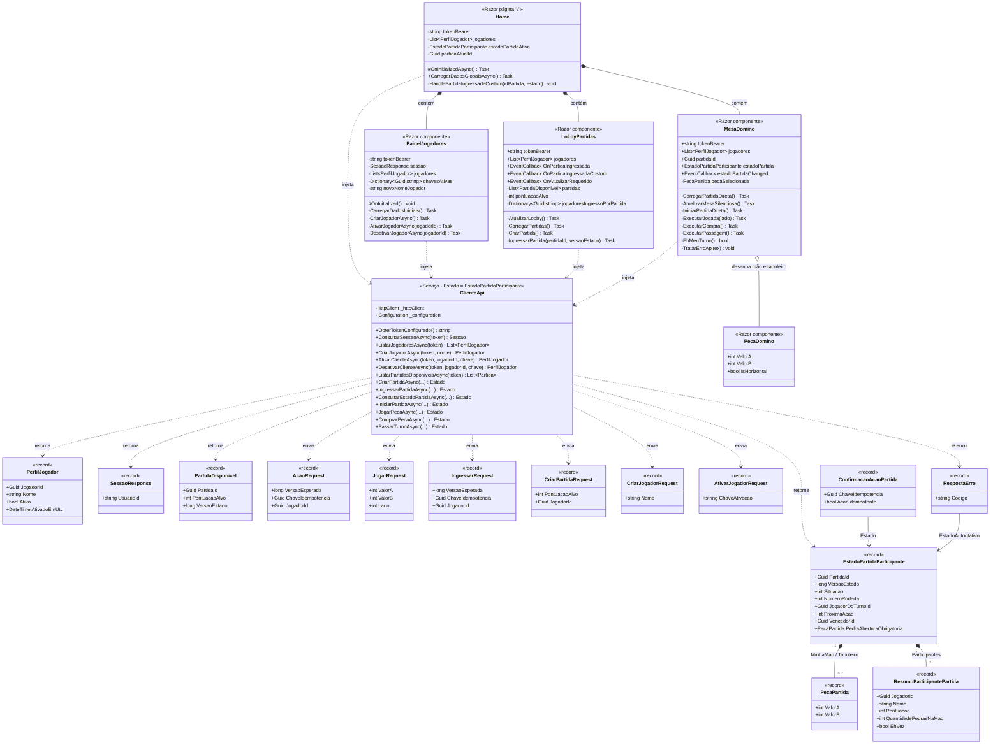

# Dominó Ponta de Quina — Cliente Web

Aplicação web em C# com Blazor interativo no servidor para gerenciar jogadores e participar de partidas de Dominó Ponta de Quina. O cliente envia as ações à API REST do projeto, que é a autoridade sobre as regras e o estado das partidas.

## Integrantes

| Nome | RM |
|---|---:|
| Augusto Mendonça | 558371 |
| Gustavo Oliveira | 559163 |
| Gabriel Vasquez | 557056 |

## Funcionalidades

- Consultar a sessão autenticada e listar os jogadores associados a ela.
- Criar perfis de jogador, ativá-los e desativá-los.
- Gerar uma chave de ativação para cada jogador ao ativá-lo.
- Consultar e atualizar manualmente o lobby de partidas disponíveis.
- Criar uma sala com um jogador ativo como anfitrião e escolher a pontuação-alvo (o campo oferece valores de 50 a 500).
- Entrar em uma sala disponível com um jogador ativo.
- Abrir uma partida pelo lobby ou informar manualmente o ID da partida, o ID do jogador e a chave de ativação na mesa.
- Iniciar uma partida, selecionar e jogar uma peça em uma das extremidades, comprar uma peça ou passar o turno.
- Consultar o estado da partida pelo botão de atualização da mesa e atualizar a mesa após ações realizadas.
- Visualizar mão, tabuleiro, turno, rodada, versão do estado, quantidade de peças e pontuação dos participantes.
- Exibir o encerramento e o vencedor indicado pela interface com base na maior pontuação dos participantes quando a partida está finalizada.

A aplicação cliente não implementa um jogador autônomo nem atualização periódica automática do lobby ou da mesa. As regras e a validação de ações são responsabilidade da API.

## Como o jogo funciona

1. Um usuário consulta sua sessão, carrega os jogadores e ativa o perfil que usará. A API recebe a criação da sala solicitada pelo anfitrião ativo.
2. Um segundo jogador ativo escolhe uma sala disponível e solicita ingresso.
3. Com os participantes na sala, um jogador inicia a partida pela mesa.
4. A interface apresenta o turno e permite realizar uma jogada, comprar uma peça ou passar. O cliente envia a ação e a versão do estado à API; o servidor valida e retorna o estado atualizado.
5. No Dominó Ponta de Quina, a soma das pontas externas múltipla de cinco pontua. A aplicação apresenta as pontuações recebidas da API; ela não calcula nem decide as regras do jogo.
6. Quando a partida é encerrada pela API, a mesa exibe o resultado. A interface identifica visualmente como vencedor o participante com maior pontuação no estado recebido.

## Chave de ativação

Ao ativar um jogador, o cliente gera 32 bytes aleatórios com `RandomNumberGenerator.GetBytes(32)` e os representa como 64 caracteres hexadecimais em minúsculas. A chave é enviada à API no corpo da solicitação de ativação e salva no armazenamento local do navegador (`localStorage`), usando a chave `chave_ativacao_{JogadorId}`. Ao desativar, o cliente usa a chave armazenada e a remove do navegador após a confirmação da API.


## Arquitetura

Árvore dos arquivos do projeto (dependências estáticas de Bootstrap em `wwwroot/lib/bootstrap` foram agrupadas):

```text
.
├── .gitignore
├── README.md
├── ClienteDominoPontaDeQuina.slnx
└── ClienteDominoPontaDeQuina/
	├── ClienteDominoPontaDeQuina.csproj
	├── Program.cs
	├── appsettings.json
	├── Properties/
	│   └── launchSettings.json
	├── Models/
	│   ├── AcaoDtos.cs
	│   ├── IdentidadeDtos.cs
	│   ├── JogadorDtos.cs
	│   └── PartidaDtos.cs
	├── Services/
	│   └── ClienteApi.cs
	├── Components/
	│   ├── App.razor
	│   ├── Routes.razor
	│   ├── _Imports.razor
	│   ├── Jogo/
	│   │   ├── LobbyPartidas.razor
	│   │   ├── LobbyPartidas.razor.css
	│   │   ├── MesaDomino.razor
	│   │   ├── PainelJogadores.razor
	│   │   ├── PainelJogadores.razor.css
	│   │   └── PecaDomino.razor
	│   ├── Layout/
	│   │   ├── MainLayout.razor
	│   │   ├── MainLayout.razor.css
	│   │   ├── NavMenu.razor
	│   │   └── NavMenu.razor.css
	│   └── Pages/
	│       ├── Error.razor
	│       ├── Home.razor
	│       ├── Home.razor.css
	│       └── NotFound.razor
	└── wwwroot/
		├── app.css
		├── favicon.png
		└── lib/bootstrap/dist/
			├── css/ (arquivos CSS e mapas do Bootstrap)
			└── js/ (arquivos JavaScript e mapas do Bootstrap)
```

- `Program.cs` registra os componentes Razor interativos no servidor, `HttpClient` e `ClienteApi`, e configura o pipeline HTTP.
- `Services/ClienteApi.cs` concentra as chamadas HTTP para sessão, jogadores, partidas, consulta de estado e ações de jogo.
- `Models/IdentidadeDtos.cs` define os DTOs de identidade e sessão; `JogadorDtos.cs`, os dados e requisições de jogadores; `PartidaDtos.cs`, os estados e solicitações de partidas; e `AcaoDtos.cs`, as requisições e respostas de ações.
- `Components/Pages/Home.razor` organiza a tela principal e conecta o painel de jogadores, o lobby e a mesa.
- `Components/Jogo/PainelJogadores.razor` consulta sessão e jogadores e permite criar, ativar e desativar perfis.
- `Components/Jogo/LobbyPartidas.razor` lista salas, permite criá-las e solicitar ingresso.
- `Components/Jogo/MesaDomino.razor` exibe o estado da partida e envia ações de iniciar, jogar, comprar e passar; também permite consultar a mesa.
- `Components/Jogo/PecaDomino.razor` renderiza uma peça de dominó.
- `Components/App.razor`, `Routes.razor`, `Layout/MainLayout.razor` e `Layout/NavMenu.razor` compõem o documento, roteamento e layout da aplicação.
- `Components/Pages/Error.razor` e `NotFound.razor` apresentam as telas de erro e rota não encontrada.
- `wwwroot/app.css`, os arquivos CSS dos componentes e `wwwroot/lib/bootstrap` fornecem os estilos e recursos estáticos.
- `appsettings.json` contém a configuração `URL_API` e uma entrada `TOKEN_BEARER`; `Properties/launchSettings.json` define os perfis locais de execução.
- `.gitignore` ignora arquivos de build/Visual Studio e `appsettings.Development.json`.

## Diagrama de classes



## Como executar

### Pré-requisitos

- .NET 10 SDK.
- IDE compatível com .NET, como Visual Studio 2026, ou terminal PowerShell.

### Clonar e configurar

```powershell
git clone https://github.com/Gusta346/Domino.git
cd Domino
```

O projeto está em `ClienteDominoPontaDeQuina/ClienteDominoPontaDeQuina.csproj`. A configuração lida pelo código usa as chaves `URL_API` e `TOKEN_BEARER`. O valor padrão de `URL_API` é `https://domino-quina-api-b1-pf2261.azurewebsites.net`; o contrato da API é disponibilizado em `/swagger/v1/swagger.json`.

Configure o token localmente e nunca o inclua em commits. Uma opção é usar User Secrets no projeto:

```powershell
dotnet user-secrets init --project ClienteDominoPontaDeQuina/ClienteDominoPontaDeQuina.csproj
dotnet user-secrets set "URL_API" "https://domino-quina-api-b1-pf2261.azurewebsites.net" --project ClienteDominoPontaDeQuina/ClienteDominoPontaDeQuina.csproj
dotnet user-secrets set "TOKEN_BEARER" "SEU_TOKEN" --project ClienteDominoPontaDeQuina/ClienteDominoPontaDeQuina.csproj
```

Como alternativa, crie `ClienteDominoPontaDeQuina/appsettings.Development.json`, que está listado no `.gitignore`, com valores locais para as duas chaves:

```json
{
  "URL_API": "https://domino-quina-api-b1-pf2261.azurewebsites.net",
  "TOKEN_BEARER": "SEU_TOKEN"
}
```

Não grave o token em `appsettings.json` nem versione arquivos com credenciais.

### Executar

```powershell
dotnet run --project ClienteDominoPontaDeQuina/ClienteDominoPontaDeQuina.csproj
```

Os perfis locais configuram as URLs `http://localhost:5109` e `https://localhost:7285` (com HTTP também em `5109`).

## Testes

Para tentar executar os testes a partir da raiz:

```powershell
dotnet test
```
